


  <a href="https://navnitai.vercel.app/">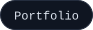</a>
  <a href="https://www.linkedin.com/in/navnitai/">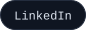</a>
  
  <a href="https://huggingface.co/NinjainPJs">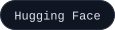</a>
  <a href="https://www.kaggle.com/ninjacode911">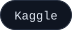</a>
  <a href="https://leetcode.com/u/Ninja_in_PJs/">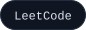</a>
  <a href="https://stackoverflow.com/users/32001856/navnit-a">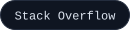</a>
  
  
  <a href="https://www.instagram.com/navnit.a_">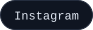</a>
  


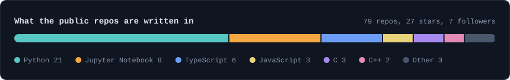

### Pinned work

<!-- projects:start -->
<a href="https://github.com/ninjacode911/Project-Hemorrhoids-Detection-System">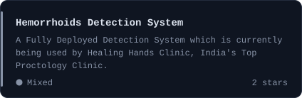</a>
<a href="https://github.com/ninjacode911/Project-Portfolio-DBZ">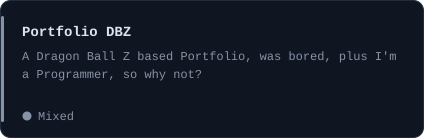</a>
<a href="https://github.com/ninjacode911/Project-Ninja-Code-Guard">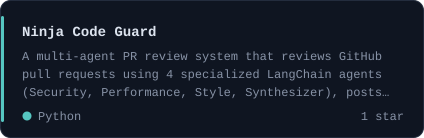</a>
<a href="https://github.com/ninjacode911/Project-EvalPulse">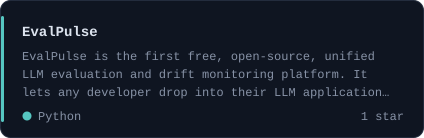</a>
<a href="https://github.com/ninjacode911/Project-KineticAI">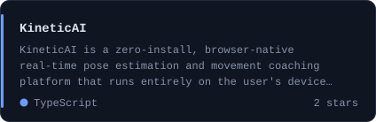</a>
<a href="https://github.com/ninjacode911/Project-VoiceVault">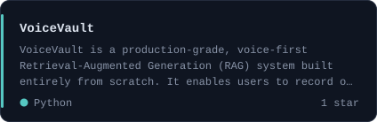</a>
<!-- projects:end -->

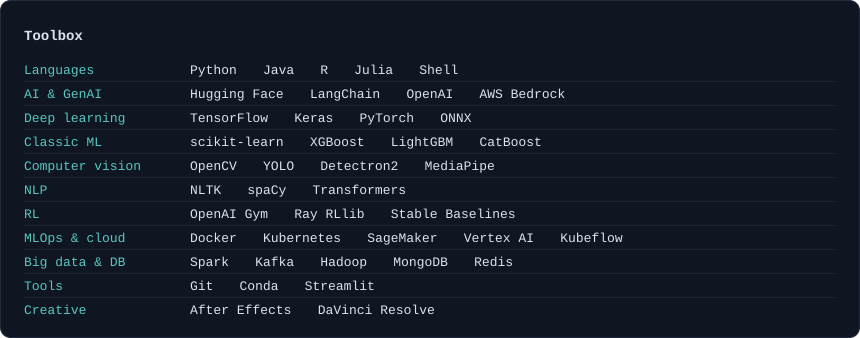

Cards are generated by <a href="scripts/build_profile.py">scripts/build_profile.py</a> and refreshed daily by a GitHub Action. No third-party stats servers.
