


<!-- links:start -->

<!-- links:end -->


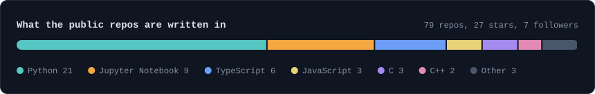

### Pinned work

<!-- projects:start -->
<a href="https://github.com/ninjacode911/Project-Hemorrhoids-Detection-System">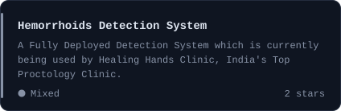</a>
<a href="https://github.com/ninjacode911/Project-Portfolio-DBZ">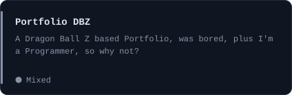</a>
<a href="https://github.com/ninjacode911/Project-Ninja-Code-Guard">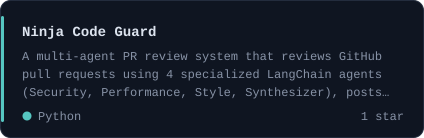</a>
<a href="https://github.com/ninjacode911/Project-EvalPulse">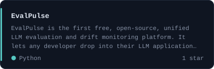</a>
<a href="https://github.com/ninjacode911/Project-KineticAI">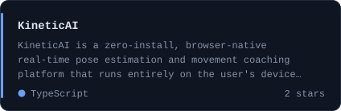</a>
<a href="https://github.com/ninjacode911/Project-VoiceVault">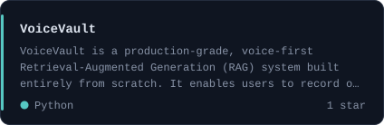</a>
<!-- projects:end -->

### Toolbox

<!-- toolbox:start -->
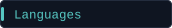

 
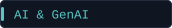

 
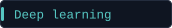

 
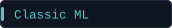

 
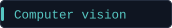

 
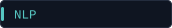

 
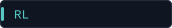

 
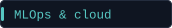

 
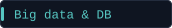

 
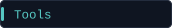

 
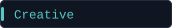

 
<!-- toolbox:end -->

